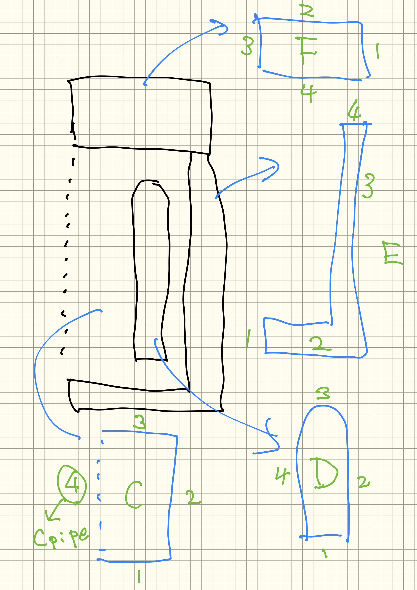
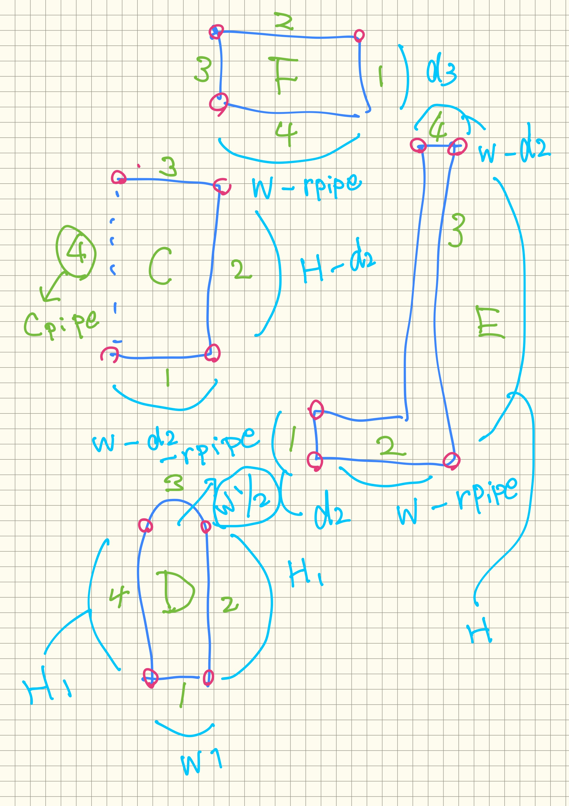
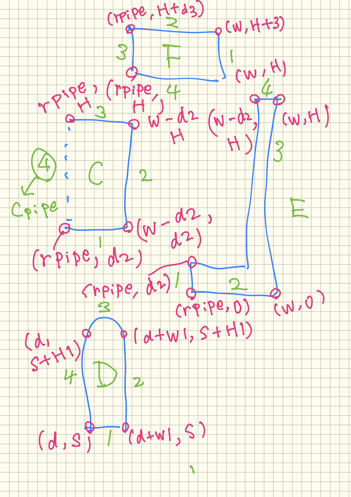

  
unomi 261105  
  
// --- 1. 幾何形状パラメータ [m] ---  
real w = 0.25;// 容器半径  
real H = 0.8;// 容器高さ  
real S = 0.1;// 内部構造物下端  
real H1 = 0.6;// 内部構造物高さ  
real d = 0.15;// 内部構造物内径  
real w1 = 0.03;// 内部構造物厚み  
real ch = 0.04;// 面取り  
real rpipe = 0.02;// 中心軸回避用パイプ半径  
real d2=0.01; // frozen wall  
real d3=0.1;  
  
// --- 2. 境界定義 ---  
border C1(t=rpipe, w-d2) {x=t; y=d2; label=1;}  
border C2(t=d2, H){x=w-d2; y=t; label=2;}  
//border Chamfer(t=0,1){x=w - t*ch; y=H-ch + t*ch; label=2;}  
border C3(t=w-d2,rpipe){x=t; y=H; label=3;}  
border Cpipe(t=H,d2){x=rpipe; y=t; label=12;}  
  
// シュラード  
border D1(t=0, w1) {x=d+t; y=S; label=20;}  
border D2(t=S, S+H1) {x=d+w1; y=t; label=20;}  
border D3(t=0, pi)    {x=d+w1/2.0 + (w1/2.0)*cos(t);   
                       y=S+H1 + (w1/2.0)*sin(t); label=20;}  
border D4(t=S+H1, S)  {x=d; y=t; label=20;}  
  
border E1(t=d2,0){x=rpipe;y=t;label=30;}  
border E2(t=rpipe,w){x=t;y=0;label=30;}  
border E3(t=0,H){x=w;y=t;label=30;}  
border E4(t=w,w-d2){x=t;y=H;label=30;}  
  
border F1(t=H,H+d3){x=w;y=t;label=40;}  
border F2(t=w,rpipe){x=t;y=H+d3;label=40;}  
border F3(t=H+d3,H){x=rpipe;y=t;label=40;}  
border F4(t=rpipe,w){x=t;y=H;label=40;}  
  
  
  
  
  
  
